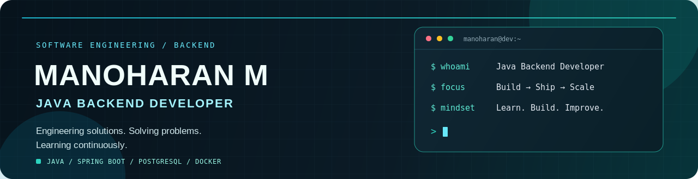
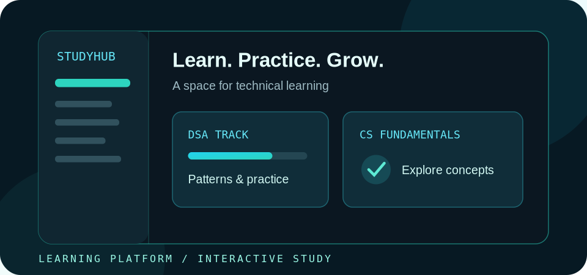
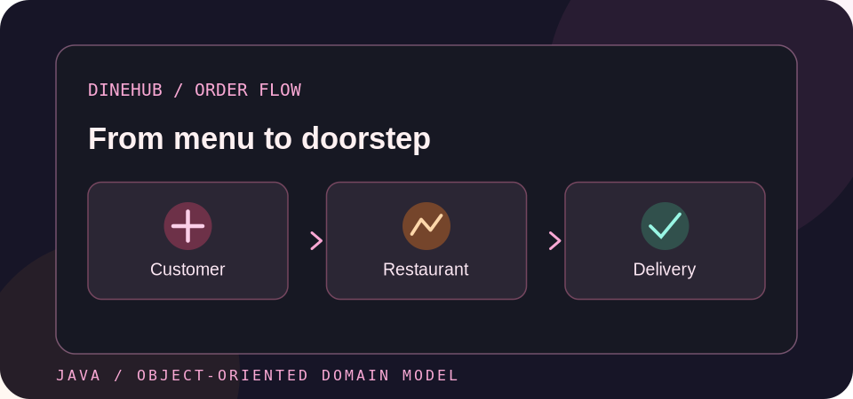
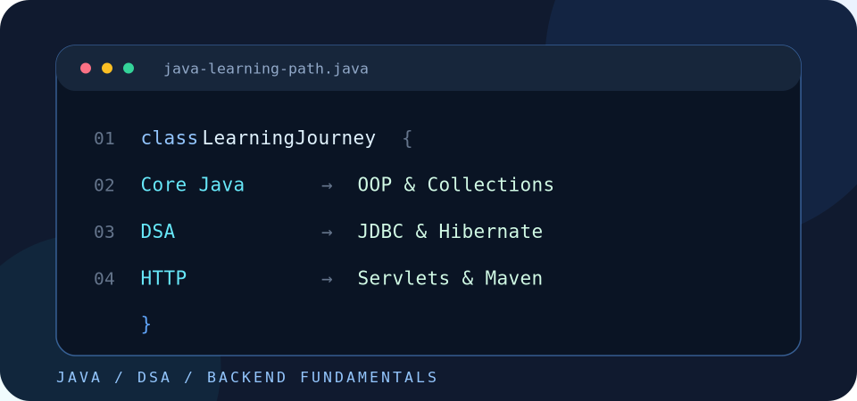

  

  
  
  

JAVA BACKEND · SPRING BOOT · AGENTIC DEVELOPMENT
⚙️ TOOLKIT

  

Backend · Relational databases · Containers · Developer tools · DSA
🚀 SELECTED WORK
<table>
  <tr>
    <td width="33.33%" align="center" valign="top">
      
      <a href="https://manoharan12105-beep.github.io/studyhub/">LIVE ↗</a> &nbsp;·&nbsp;
      <a href="https://github.com/manoharan12105-beep/studyhub">SOURCE ↗</a>
    </td>
    <td width="33.33%" align="center" valign="top">
      
      <a href="https://github.com/manoharan12105-beep/DineHub">SOURCE ↗</a>
    </td>
    <td width="33.33%" align="center" valign="top">
      
      <a href="https://github.com/manoharan12105-beep/java-concept-revision-and-advanced">SOURCE ↗</a>
    </td>
  </tr>
</table>🧭 BUILDING TOWARD SCALE
<table>
  <tr>
    <td width="33%" align="center" valign="top">
      <b>✅ FOUNDATION</b> 
      Java · Spring Boot · REST · JPA · SQL · Docker · Linux · DSA
    </td>
    <td width="33%" align="center" valign="top">
      <b>🔄 LEARNING</b> 
      AWS · System Design · Kubernetes · CI/CD · Spring Security
    </td>
    <td width="33%" align="center" valign="top">
      <b>🎯 NEXT</b> 
      Redis · Kafka · Distributed Systems · NGINX · Terraform · DB Scaling
    </td>
  </tr>
</table>
Long-term direction: design, deploy and scale reliable software — from the first user toward a million.
🤖 AGENTIC DEVELOPMENT

  
  
  

PLAN → DELEGATE SCOPED TASKS → REVIEW → OWN THE CODE
📊 DEVELOPER STATS

  
  

  

  
<b>More activity · trophies · contribution snake</b>

  

    
  

  

    
  

  

    
  

  <a href="https://www.linkedin.com/in/manoharan12105">LINKEDIN</a> &nbsp;·&nbsp;
  <a href="https://github.com/manoharan12105-beep">GITHUB</a> &nbsp;·&nbsp;
  <a href="https://leetcode.com/u/Manoharan12105/">LEETCODE</a>
    
  Engineering solutions. Solving problems. Learning continuously.

