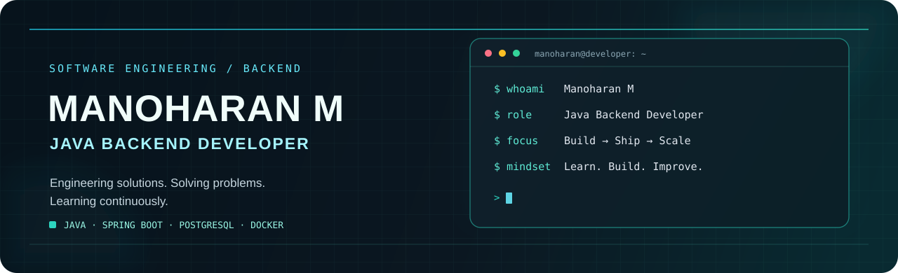
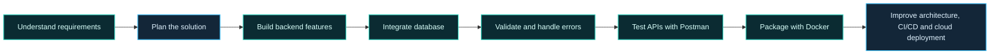

<!--
  Profile README for: github.com/manoharan12105-beep
  Place this file in the public repository named exactly: manoharan12105-beep
  Keep assets/terminal-header.svg and .github/workflows/snake.yml alongside this README.
-->

<p align="center">
  
</p>

<p align="center">
  <a href="https://www.linkedin.com/in/manoharan12105">
    
  </a>
  <a href="https://github.com/manoharan12105-beep">
    
  </a>
  <a href="https://leetcode.com/u/Manoharan12105/">
    
  </a>
</p>

<p align="center">
  
</p>

<p align="center">
  <a href="#about">ABOUT</a> &nbsp; · &nbsp;
  <a href="#engineering-toolkit">TOOLKIT</a> &nbsp; · &nbsp;
  <a href="#featured-work">PROJECTS</a> &nbsp; · &nbsp;
  <a href="#engineering-journey">ROADMAP</a> &nbsp; · &nbsp;
  <a href="#developer-analytics">ANALYTICS</a> &nbsp; · &nbsp;
  <a href="#connect">CONNECT</a>
</p>

---

<a id="about"></a>

## `01` — About

I'm **Manoharan M**, a Computer Science and Engineering student focused on **Java backend development**. I enjoy understanding how applications are designed, how data moves through a system, and what it takes to take software from an idea to a reliable deployment.

My current foundation is Java, Spring Boot, REST API development, relational databases, Docker and Linux. Beyond writing application code, I'm building my understanding of system design, cloud infrastructure, automation and production operations.

**Long-term direction:** become an end-to-end project developer who can take a product from its first working version toward systems designed for growth — from the first user to million-user scale. That's a learning goal, not a claim of having operated a system at that scale.

> **Engineering philosophy:** Engineering solutions. Solving problems. Learning continuously.

<a id="engineering-toolkit"></a>

## `02` — Engineering toolkit

### Core development

<p>
  
</p>

| Area | Technologies and concepts |
|---|---|
| **Programming** | Java |
| **Backend** | Spring Boot, Spring Data JPA, Hibernate, REST API design, Maven |
| **Data** | PostgreSQL, MySQL, ORM and relational database integration |
| **Quality & testing** | Request validation, centralized exception handling, Postman API testing and debugging |

### Developer tools & infrastructure

<p>
  
</p>

| Area | Technologies and concepts |
|---|---|
| **Containers** | Docker, Docker Compose |
| **Version control** | Git, GitHub |
| **Environment** | Linux |
| **Problem solving** | Data Structures and Algorithms, Java-based practice |
| **Web fundamentals** | HTML, CSS and JavaScript used in StudyHub |
| **Networking** | Foundational computer networking knowledge |

### Currently building depth

<p>
  
</p>

AWS and cloud deployment · Kubernetes · System design · GitHub Actions and CI/CD · Application architecture · JWT and Spring Security.

> I separate technologies I can currently work with from topics I'm actively learning. The learning list is not a claim of production-level expertise.

## `03` — How I approach software development

I think about a project as a lifecycle, not just a collection of endpoints.



**Practised in projects:** requirement analysis and planning, Spring Boot backend implementation, REST APIs, database integration with ORM, validation, centralized exception handling, Postman testing/debugging and Dockerizing applications.

**Actively developing:** deeper component architecture, authentication and authorization, cloud deployment and CI/CD practices.

<a id="featured-work"></a>

## `04` — Featured work

The projects below represent three complementary parts of my development journey: building a learning product, modelling a multi-role Java application, and strengthening Java/backend fundamentals.

### 01 · StudyHub

**An interactive learning and interview-preparation platform**

A personal study platform covering technical interview preparation and computer science topics. It is published as a static site through GitHub Pages and combines structured learning content with interactive study tools.

**What it includes**
- Structured material across DSA, aptitude, OOP, Java/Spring Boot, DBMS/PostgreSQL, Linux, Computer Networks, System Design, Operating Systems and DevOps/deployment.
- Navigation and search over the learning content.
- Progress tracking, practice and interview sessions, flashcards and interactive visualizers.
- Markdown-based content organized with supporting metadata, templates and application assets.

**Implementation stack:** HTML · CSS · JavaScript · Markdown · GitHub Pages

<p>
  <a href="https://manoharan12105-beep.github.io/studyhub/">
    
  </a>
  <a href="https://github.com/manoharan12105-beep/studyhub">
    
  </a>
</p>

<details>
  <summary><strong>Explore the StudyHub architecture</strong></summary>

  ```mermaid
  flowchart TD
      U[Learner] --> P[GitHub Pages]
      P --> APP[Static web application]
      APP --> UI[HTML / CSS / JavaScript]
      APP --> CONTENT[Structured Markdown content]
      APP --> META[Metadata, templates and assets]
      UI --> FEATURES[Search · Progress · Practice · Flashcards · Visualizers]
      CONTENT --> FEATURES
      META --> FEATURES
  ```

  **Architecture idea:** a static delivery model keeps the learning application simple to host, while content, metadata and the browser-side study experience remain organized as separate parts of the repository.
</details>

---

### 02 · DineHub

**Console-based food ordering and delivery system — Java**

A menu-driven Java application that models the workflow of an online food delivery platform. It supports multiple roles: **Admin, Customer, Restaurant Manager and Delivery Person**.

**What it includes**
- User registration, login, role-based access and profile management.
- Admin operations for customers, restaurants, restaurant managers and delivery personnel.
- Restaurant details, food menus, food availability and order management.
- Restaurant browsing, menu browsing, order placement, order history and order-status tracking.
- Delivery assignment, delivery status updates, path finding and delivery tracking.
- Favourite foods, restaurant ratings and delivery ratings.

**Engineering concepts:** Core Java · OOP · Java Collections Framework · DTOs · Enums · Modular organization · ER and UML modelling

<p>
  <a href="https://github.com/manoharan12105-beep/DineHub">
    
  </a>
</p>

<details>
  <summary><strong>Explore the DineHub domain model</strong></summary>

  ```mermaid
  flowchart TD
      MAIN[Main / menu-driven entry point] --> AUTH[User and role flow]
      AUTH --> ADMIN[Admin]
      AUTH --> CUSTOMER[Customer]
      AUTH --> MANAGER[Restaurant Manager]
      AUTH --> DELIVERY[Delivery Person]
      MANAGER --> REST[Restaurant and Food]
      CUSTOMER --> ORDER[Orders and Order Details]
      REST --> ORDER
      ORDER --> DISPATCH[Delivery assignment and status]
      DELIVERY --> DISPATCH
      CUSTOMER --> FAV[Favorites and Ratings]
      CUSTOMER --> RATE[Restaurant and Delivery Ratings]
      classDef role fill:#0B2B32,stroke:#2DD4BF,color:#D9FFFA
      classDef domain fill:#132638,stroke:#38BDF8,color:#E0F2FE
      class ADMIN,CUSTOMER,MANAGER,DELIVERY role
      class REST,ORDER,DISPATCH,FAV,RATE domain
  ```

  **Repository diagrams:**

  <p align="center">
    
  </p>
  <p align="center">
    
  </p>
  <p align="center">
    
  </p>
  <sub>These diagrams are linked from the DineHub repository.</sub>
</details>

---

### 03 · Java Concepts & Advanced

**A structured Java learning and revision repository**

A day-wise repository documenting the progression from Core Java fundamentals into object-oriented programming, data structures, database connectivity and backend foundations.

**Topics covered**
- Core Java, OOP, equality and hashing, Generics and Collections.
- Recursion, searching, sorting, stacks, queues and linked lists.
- Big-O notation, DSA practice, Lambda expressions and Streams.
- Exception handling and file handling.
- JDBC, CRUD practice, Hibernate basics, HTTP and Servlets.
- Maven concepts and supporting revision material.

**Focus:** Java fundamentals · DSA · Problem solving · Backend foundations

<p>
  <a href="https://github.com/manoharan12105-beep/java-concept-revision-and-advanced">
    
  </a>
</p>

<details>
  <summary><strong>View the learning progression</strong></summary>

  ```mermaid
  flowchart LR
      A[Core Java] --> B[OOP and Collections]
      B --> C[DSA and Complexity]
      C --> D[Streams and Exceptions]
      D --> E[File Handling]
      E --> F[JDBC]
      F --> G[Hibernate]
      G --> H[HTTP and Servlets]
  ```
</details>

## `05` — Agentic development workflow

I use AI coding tools as engineering assistants while keeping implementation decisions and code review under my responsibility.

**Tools I use**

<p>
  
  
  
</p>

**How I work with coding agents**
1. Clarify the requirement and plan the implementation before coding.
2. Provide project context and instructions through files such as `AGENTS.md` or `CLAUDE.md`.
3. Delegate scoped, multi-file implementation tasks.
4. Review generated changes, question assumptions and correct code where needed.
5. Keep responsibility for the final implementation and its quality.

My approach is **structured agentic development** — using agents to improve development throughput without treating generated code as automatically correct.

<a id="engineering-journey"></a>

## `06` — Engineering journey

My long-term goal is to understand the full lifecycle of software: design, implementation, delivery, operation and scaling.

| Completed / practised foundation | Currently learning / developing | Planned next steps |
|---|---|---|
| Java and OOP | Application/component architecture | Redis and caching |
| Spring Boot and REST APIs | JWT and Spring Security | Apache Kafka and event streaming |
| Spring Data JPA / Hibernate | AWS and cloud deployment | Microservices and distributed systems |
| PostgreSQL and MySQL | System Design | Database scaling: indexing, partitioning and replication |
| Validation and exception handling | Kubernetes | NGINX and load balancing |
| Postman API testing and debugging | GitHub Actions and CI/CD | Terraform and Infrastructure as Code |
| Docker and Docker Compose | Computer Networking — foundational knowledge | Advanced AWS architecture |
| Git, GitHub, Linux and DSA |  |  |

The roadmap is intentionally split into **practised**, **currently developing** and **planned** topics so that learning goals are not presented as completed expertise.

## `07` — Problem solving

Consistency in problem solving is an important part of my development routine.

<p align="center">
  
</p>

**LeetCode snapshot from my profile screenshots** *(values change as I practise)*

| Metric | Snapshot |
|---|---:|
| Problems solved | **716** |
| Easy | 414 |
| Medium | 273 |
| Hard | 29 |
| Contest rating | **1,834** |
| Contests attended | 28 |
| Longest streak | **164 days** |
| Contest percentile | **Top 7.1%** |
| Global contest rank | 62,007 |
| Notable badge | **365 Days Badge** |

<p align="center">
  <a href="https://leetcode.com/u/Manoharan12105/">
    
  </a>
</p>

<a id="developer-analytics"></a>

## `08` — GitHub analytics

<p align="center">
  
  
</p>

<p align="center">
  
</p>

<p align="center">
  
</p>

<p align="center">
  <a href="https://github.com/manoharan12105-beep?tab=achievements">
    
  </a>
</p>

### Contribution snake

<p align="center">
  
</p>

<p align="center">
  <a href="https://github.com/manoharan12105-beep?tab=repositories">Explore all repositories</a>
  &nbsp; · &nbsp;
  <a href="https://github.com/manoharan12105-beep?tab=overview&from=2026-01-01&to=2026-12-31">View GitHub activity</a>
</p>

<a id="connect"></a>

## `09` — Connect

I'm interested in backend engineering, thoughtful software design, practical problem solving and learning how reliable systems are built and operated.

<p align="center">
  <a href="https://www.linkedin.com/in/manoharan12105">
    
  </a>
  <a href="https://github.com/manoharan12105-beep">
    
  </a>
  <a href="https://leetcode.com/u/Manoharan12105/">
    
  </a>
</p>

<p align="center">
  <sub>Build with clarity. Review with care. Improve with every iteration.</sub>
</p>
